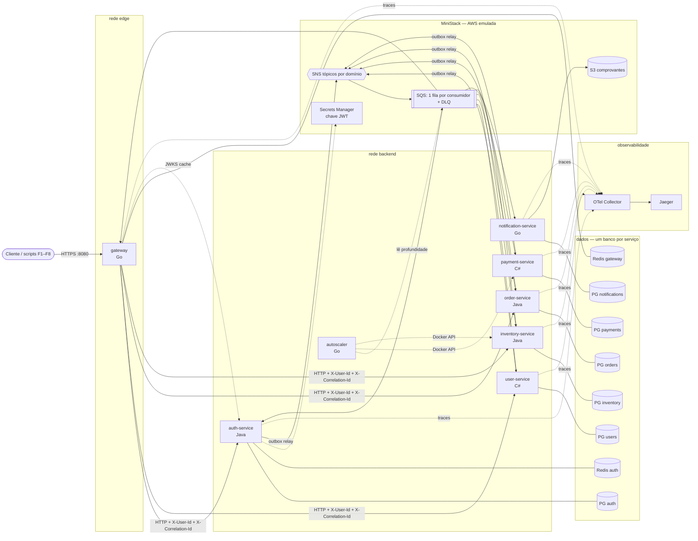
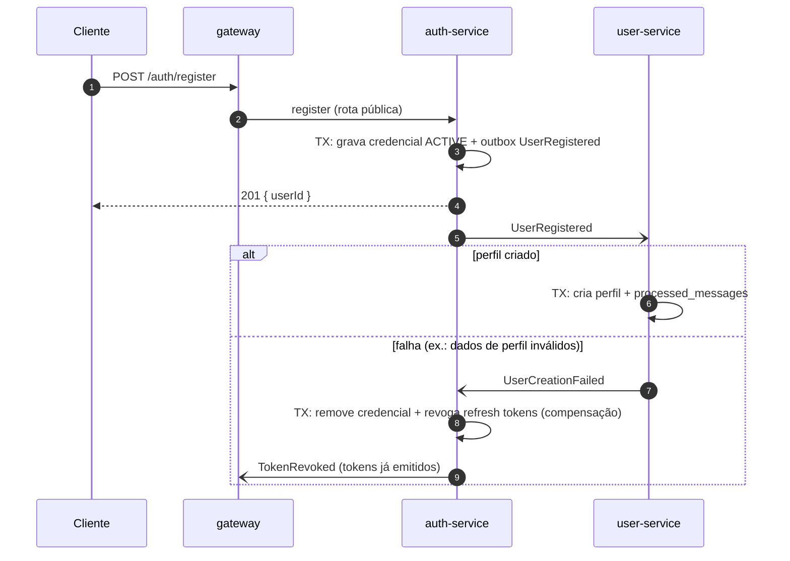
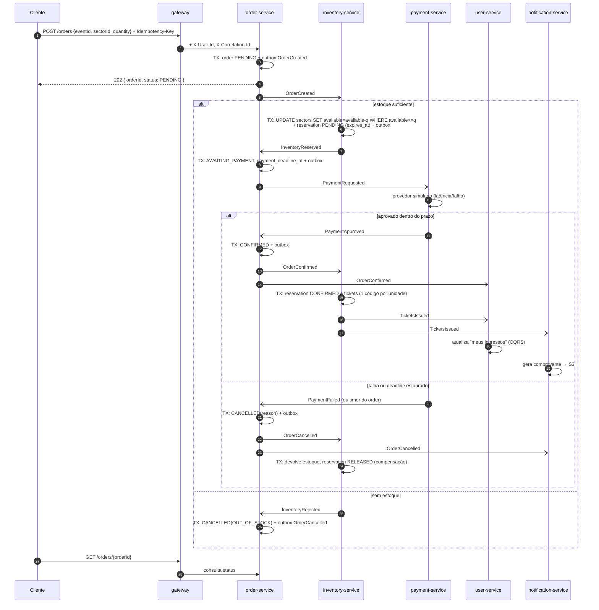
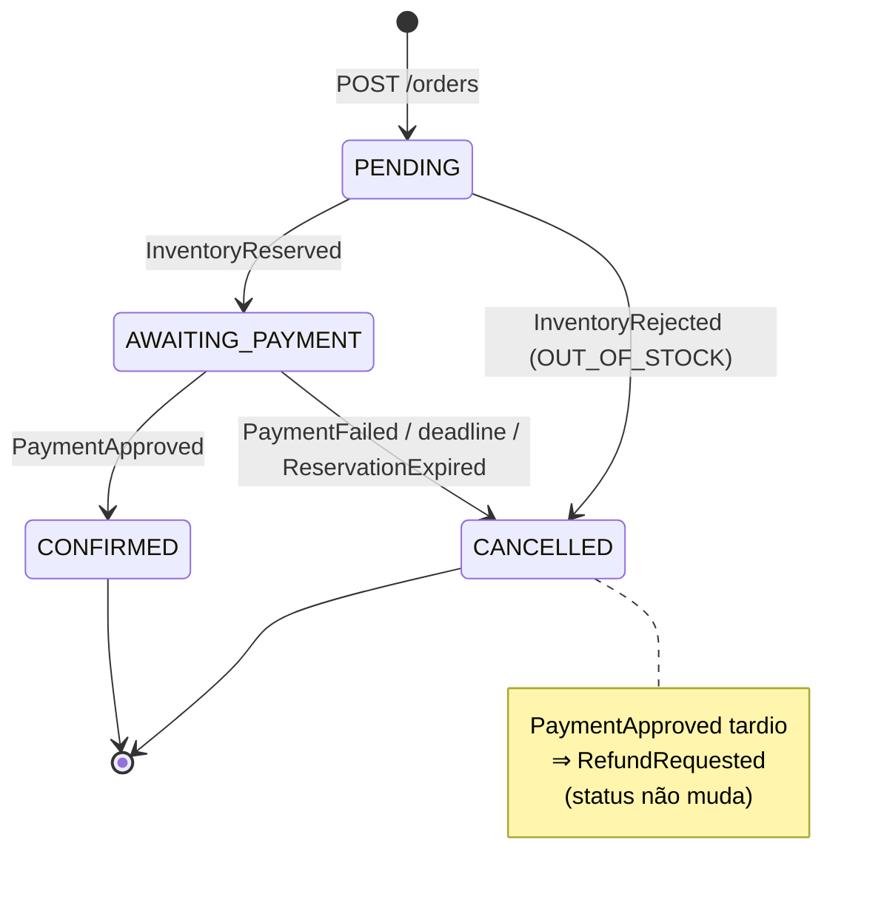

# Arquitetura — Ticket Pro

> Fonte da verdade dos eventos: [`contracts/`](../contracts/). As decisões estão justificadas em [`docs/adr/`](adr/) e os detalhes de protocolo em [`docs/rfc/`](rfc/).

## 1. Visão geral

O Ticket Pro vende ingressos **por setor e quantidade** para eventos carregados por seed. É somente backend: o cliente (scripts, coleção HTTP) fala apenas com o **gateway**. Os serviços se comunicam por **eventos assíncronos** (SNS → SQS), e cada serviço tem seu próprio banco.

### Premissas

- O catálogo (eventos, setores, capacidade, preço) vem de seed no init do inventory-service, sem API administrativa.
- Um pedido é sempre de **um setor**, com `quantity` entre 1 e `ORDER_MAX_QUANTITY` (padrão 6).
- Volume de demo: centenas de requisições por cenário. O objetivo é **corretude sob concorrência e falha**, não throughput.
- Ambiente: MiniStack (AWS emulada) + containers locais via `docker compose up`.

## 2. Diagrama de componentes

**Isolamento de rede:** só o `gateway` publica porta para o host (`8080`). O Jaeger UI (`16686`) fica exposto apenas como ferramenta de operação da demo. Cada banco fica numa rede própria (`<svc>-data`), visível só para o seu serviço, de modo que nenhum serviço consegue sequer resolver o host do banco alheio.

## 3. Serviços e responsabilidades

| Serviço | Linguagem | Dono de | API síncrona (via gateway) | Publica | Consome |
|---|---|---|---|---|---|
| gateway | Go | rate limit, cópia da blacklist de `jti` (Redis próprio) | roteamento por prefixo | — | `TokenRevoked` |
| auth-service | Java | credenciais, refresh tokens, chave JWT (Secrets Manager), blacklist `jti` | `POST /auth/register`, `/auth/login`, `/auth/refresh`, `/auth/logout`; interno `GET /.well-known/jwks.json` | `UserRegistered`, `TokenRevoked` | `UserCreationFailed` |
| user-service | C# | perfil, read model "meus ingressos" | `GET /me`, `GET /me/tickets` | `UserCreationFailed` | `UserRegistered`, `OrderConfirmed`, `TicketsIssued` |
| order-service | Java | pedidos, máquina de estados da saga | `POST /orders` (202), `GET /orders/{id}`, `GET /orders` | `OrderCreated`, `PaymentRequested`, `OrderConfirmed`, `OrderCancelled`, `RefundRequested` | `InventoryReserved`, `InventoryRejected`, `InventoryReservationExpired`, `PaymentApproved`, `PaymentFailed`, `PaymentRefunded` |
| inventory-service | Java | eventos, setores, estoque, reservas, ingressos | `GET /events`, `GET /events/{id}` | `InventoryReserved`, `InventoryRejected`, `InventoryReservationExpired`, `TicketsIssued` | `OrderCreated` (v1 e v2), `OrderConfirmed`, `OrderCancelled` |
| payment-service | C# | pagamentos, provedor simulado instável | — (só eventos) | `PaymentApproved`, `PaymentFailed`, `PaymentRefunded` | `PaymentRequested`, `RefundRequested` |
| notification-service | Go | registro de notificações, comprovantes no S3 | — (só eventos) | — | `TicketsIssued`, `OrderCancelled` |
| autoscaler | Go | — (sem banco) | — | — | lê atributos das filas SQS |

## 4. Mensageria

- **Tópicos SNS por domínio produtor:** `ticketpro-auth`, `ticketpro-users`, `ticketpro-orders`, `ticketpro-inventory`, `ticketpro-payments`.
- **Uma fila SQS por consumidor** (`ticketpro-<serviço>`), assinada nos tópicos necessários com **filter policy** no atributo `type`. Cada fila tem DLQ (`ticketpro-<serviço>-dlq`) e `maxReceiveCount = 3`.
- Toda mensagem leva o envelope `messageId, correlationId, type, version, occurredAt, payload` (RFC-001). Os atributos SNS/SQS `type`, `version`, `correlationId` e `traceparent` são duplicados para filtro e tracing.
- Os produtores publicam **somente via outbox** (mesma transação do efeito). O relay drena com backoff exponencial e retoma sozinho quando o broker volta (R6).
- Os consumidores aceitam tanto a mensagem crua quanto o envelope de notificação do SNS (o MiniStack não documenta raw delivery).

## 5. Fluxo de cadastro (saga curta com compensação)

A credencial nasce `ACTIVE`, sem um evento extra de "perfil criado". Se o perfil falhar, a compensação remove a credencial e revoga os tokens já emitidos. Nesses poucos segundos, `GET /me` pode responder 404 (perfil ainda não projetado), o que é consistência eventual documentada na RFC-002.

## 6. Fluxo principal: saga de compra (orquestrada pelo order-service)

### Passo a passo

1. **Criação (API assíncrona, R3):** `POST /orders` valida a entrada e grava `orders(status=PENDING)` + `OrderCreated` no outbox numa única transação. Responde `202 Accepted` com `orderId` e `Location: /orders/{id}`. O header `Idempotency-Key` (único por usuário) evita pedido duplicado em retry do cliente.
2. **Reserva (R2):** o inventory consome `OrderCreated` e, na mesma transação, faz o `UPDATE` condicional no setor, cria `reservations(PENDING, expires_at = now + RESERVATION_TTL_MS)`, grava `processed_messages` e o outbox `InventoryReserved`. Se 0 linhas forem afetadas, publica `InventoryRejected`.
3. **Pagamento:** o order vai para `AWAITING_PAYMENT`, grava `payment_deadline_at = now + ORDER_PAYMENT_TIMEOUT_MS` e publica `PaymentRequested`.
4. **Dependência instável (R5):** o consumidor do payment grava `payments(order_id UNIQUE, PENDING)` + `processed_messages` numa TX e só então dá ack na mensagem. Assim a chamada lenta **não** segura a mensagem nem estoura o visibility timeout. Um worker (`SKIP LOCKED` + lease) pega os `PENDING` e chama o provedor simulado com idempotency key = `paymentId`. O provedor aplica `PAYMENT_LATENCY_MS` (com jitter), falha com probabilidade `PAYMENT_FAILURE_RATE` e é cortado em `PAYMENT_PROVIDER_TIMEOUT_MS`. O resultado vai para `PaymentApproved` ou `PaymentFailed(reason)` via outbox.
5. **Confirmação:** o order só confirma se o pedido ainda está `AWAITING_PAYMENT` **e** `now() <= payment_deadline_at` (`UPDATE ... WHERE status='AWAITING_PAYMENT' AND payment_deadline_at >= now()`). Nesse caso publica `OrderConfirmed`. Fora do prazo, o pedido segue o caminho do passo 8.
6. **Emissão:** o inventory consome `OrderConfirmed`, confirma a reserva, gera N ingressos e publica `TicketsIssued`. O **user** projeta "meus ingressos" e o **notification** grava `receipts/{orderId}.json` no S3.
7. **Compensação:** em `PaymentFailed`, ou quando o **deadline scanner** do order encontra `AWAITING_PAYMENT` vencido, o order vai para `CANCELLED(reason)` e publica `OrderCancelled`. O inventory devolve exatamente a quantidade da reserva (`RELEASED`). Se não há reserva, é no-op.
8. **Resposta tardia (F7):** `PaymentApproved` para um pedido `CANCELLED` não muda o status. O order publica `RefundRequested`, o payment estorna e publica `PaymentRefunded`, e o order registra `refund_status=REFUNDED`.
9. **Rede de segurança:** `RESERVATION_TTL_MS >= ORDER_PAYMENT_TIMEOUT_MS + RESERVATION_SAFETY_MARGIN_MS`, validado no boot dos dois serviços pela mesma configuração do compose. Isso garante que um `OrderConfirmed` sempre encontra a reserva `PENDING`. O job de expiração do inventory libera reservas `PENDING` vencidas e publica `InventoryReservationExpired`, que o order trata como cancelamento (`RESERVATION_EXPIRED`), caso ainda não esteja em estado final.

### Máquina de estados do pedido

As transições são sempre `UPDATE ... WHERE id = ? AND status = <esperado>`. Evento fora de ordem ou duplicado não regride o estado.

## 7. Mapa de eventos

| Evento | Versão | Tópico | Publicado por | Consumido por |
|---|---|---|---|---|
| `UserRegistered` | v1 | `ticketpro-auth` | auth | user |
| `TokenRevoked` | v1 | `ticketpro-auth` | auth | gateway |
| `UserCreationFailed` | v1 | `ticketpro-users` | user | auth |
| `OrderCreated` | v1, **v2** | `ticketpro-orders` | order | inventory |
| `PaymentRequested` | v1 | `ticketpro-orders` | order | payment |
| `OrderConfirmed` | v1 | `ticketpro-orders` | order | inventory, user |
| `OrderCancelled` | v1 | `ticketpro-orders` | order | inventory, notification |
| `RefundRequested` | v1 | `ticketpro-orders` | order | payment |
| `InventoryReserved` | v1 | `ticketpro-inventory` | inventory | order |
| `InventoryRejected` | v1 | `ticketpro-inventory` | inventory | order |
| `InventoryReservationExpired` | v1 | `ticketpro-inventory` | inventory | order |
| `TicketsIssued` | v1 | `ticketpro-inventory` | inventory | user, notification |
| `PaymentApproved` | v1 | `ticketpro-payments` | payment | order |
| `PaymentFailed` | v1 | `ticketpro-payments` | payment | order |
| `PaymentRefunded` | v1 | `ticketpro-payments` | payment | order |

**Eventos com 2+ consumidores:** `TicketsIssued`, `OrderConfirmed` e `OrderCancelled`.

## 8. Dados por serviço (visão lógica)

Todos os serviços que publicam têm `outbox`, e todos os que consomem têm `processed_messages (consumer, message_id) PK`. O schema completo fica nas migrations de cada serviço (`docs/padroes.md`).

| Serviço | Tabelas principais | Constraints-chave |
|---|---|---|
| auth | `credentials`, `refresh_tokens`, `revoked_tokens` (espelho do Redis) | `email UNIQUE`, `refresh_tokens.jti UNIQUE` |
| user | `profiles`, `my_tickets` (read model) | `profiles.user_id PK`, `my_tickets.ticket_code UNIQUE` |
| order | `orders` | `(user_id, idempotency_key) UNIQUE`, `CHECK status IN (...)`, `CHECK quantity BETWEEN 1 AND 6` |
| inventory | `events`, `sectors`, `reservations`, `tickets` | `CHECK (available >= 0 AND available <= capacity)`, `reservations.order_id UNIQUE`, `tickets.code UNIQUE` |
| payment | `payments`, `refunds` | `payments.order_id UNIQUE`, `refunds.payment_id UNIQUE` |
| notification | `notifications` | `(order_id, kind) UNIQUE` |

## 9. Escalabilidade e confiabilidade

- **Réplicas padrão:** order, inventory e payment sobem com 2 réplicas (`deploy.replicas`) consumindo a mesma fila (R4). O F8 sobe para 3 com `docker compose up --scale`.
- **Relay de outbox com múltiplas réplicas:** `SELECT ... FOR UPDATE SKIP LOCKED LIMIT n`, sem coordenação externa.
- **Jobs periódicos** (deadline scanner, expiração de reservas): mesmo padrão com `SKIP LOCKED`, seguro em N réplicas.
- **Autoescala (bônus):** o autoscaler consulta `ApproximateNumberOfMessages` da fila do payment (e do inventory) a cada `AUTOSCALER_INTERVAL_S` e ajusta as réplicas pela Docker API entre `MIN` e `MAX`. *Ainda a validar: o MiniStack não documenta esse atributo.* O plano B é estimar a profundidade com `ReceiveMessage` + `VisibilityTimeout=0`, ou expor métrica de lag pelo próprio consumidor.
- **Broker fora (F6):** o estado de SNS/SQS no MiniStack fica só em memória. O cenário usa `docker pause ministack` (ou desconexão de rede) para simular a indisponibilidade sem perder filas. Enquanto isso, o outbox acumula e o relay entra em backoff.

## 10. Observabilidade

- Logs JSON estruturados com `correlationId`, `messageId`, `type`, `service` e `traceId` em todos os serviços.
- OpenTelemetry nos 4 runtimes. O `traceparent` vai em header HTTP e em atributo de mensagem, de modo que um trace cobre `POST /orders` até `TicketsIssued`.
- Health: `GET /health/live` (processo de pé) e `GET /health/ready` (banco + broker alcançáveis), usados no `healthcheck` do compose.

## 11. Matriz requisito → onde é atendido

| Req. | Como é atendido | Onde |
|---|---|---|
| ≥4 serviços, ≥3 linguagens | 7 serviços em Go, Java e C# | §3, ADR-0008, ADR-0021 |
| Banco por serviço | Postgres/Redis dedicados, redes isoladas | §2, §8, ADR-0004 |
| Mensageria + ≥3 categorias de nuvem | SNS/SQS, S3, Secrets Manager | §4, ADR-0010 |
| Tudo por `docker compose up` + init | container `infra-init` (Terraform) + seeds por migration | ADR-0009, ADR-0011 |
| Contratos com envelope | `contracts/` (JSON Schema + AsyncAPI) | RFC-001 |
| Dockerfile + health check | `/health/live`, `/health/ready` | §10, `docs/padroes.md` |
| Saga com compensação | saga de compra (§6) e de cadastro (§5) | ADR-0003 |
| Dependência instável | provedor simulado no payment | §6 passo 4, RFC-003 |
| Evento com 2+ consumidores | `TicketsIssued`, `OrderConfirmed`, `OrderCancelled` | §7 |
| **R1** at-least-once + idempotência | `processed_messages` gravado na mesma TX do efeito; outbox no produtor | ADR-0005, ADR-0006 |
| **R2** zero venda dupla | `UPDATE` condicional + `CHECK available >= 0` | ADR-0007 |
| **R3** API assíncrona | `POST /orders` → 202 + id; `GET /orders/{id}` | §6 passo 1 |
| **R4** consumidores concorrentes | 2+ réplicas na mesma fila SQS | §9 |
| **R5** dependência instável por env | `PAYMENT_LATENCY_MS`, `PAYMENT_FAILURE_RATE`, `PAYMENT_PROVIDER_TIMEOUT_MS` | RFC-003 |
| **R6** reconexão automática | relay com backoff exponencial + consumidor com retry de conexão | RFC-003 |
| **F1** compensação | `PAYMENT_FAILURE_RATE=1` → `CANCELLED` e estoque devolvido | runbook |
| **F2** kill de consumidor | `docker kill` numa réplica de inventory no meio do fluxo → visibility timeout reentrega para a outra | runbook |
| **F3** duplicata ×5 | script republica a mesma mensagem 5× → 1 efeito (`processed_messages`) | runbook |
| **F4** mensagem venenosa | payload inválido → 3 recebimentos → DLQ, fila segue fluindo | runbook |
| **F5** 100 req / 10 unidades | setor seed com 10 → exatamente 10 `CONFIRMED`/reservados, 90 `CANCELLED(OUT_OF_STOCK)` | runbook |
| **F6** broker fora 30s | `docker pause ministack` → outbox acumula → `unpause` → drena | runbook |
| **F7** resposta tardia | `PAYMENT_LATENCY_MS` > `ORDER_PAYMENT_TIMEOUT_MS` → `CANCELLED` + `RefundRequested` → `PaymentRefunded` | runbook |
| **F8** escala 3 réplicas | `--scale payment-service=3` (ou autoscaler) → vazão maior, sem duplicidade | runbook |
| Bônus OpenTelemetry | SDK OTel + Collector + Jaeger | §10, ADR-0012 |
| Bônus IaC | Terraform em `infra/terraform`, aplicado pelo `infra-init` | ADR-0011 |
| Bônus autoescala por fila | `autoscaler` (Go) via Docker API | §9 |
| Bônus CQRS | "meus ingressos" no user-service | §3, §6 passo 6 |
| Bônus versionamento | `OrderCreated` v1 → v2, consumidor tolerante | RFC-001 |

## 12. O que revisitar se o sistema crescer

- Trocar o polling do outbox por CDC (Debezium) se a latência de publicação importar.
- Pré-alocar assentos numerados (linha por unidade com `SKIP LOCKED`) se surgir venda de assento marcado.
- Usar fila de espera (virtual queue) na abertura de vendas de alta demanda.
- Usar KEDA/ECS Service Auto Scaling no lugar do autoscaler caseiro numa nuvem real.
