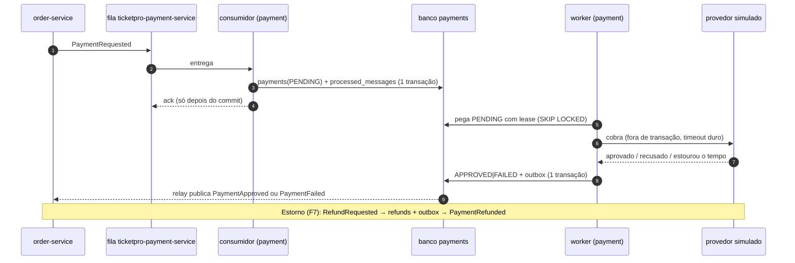

# payment-service: como funciona e como apresentar

Guia para quem do grupo vai apresentar o payment na banca, sem ter escrito o serviço. Leitura de 10 minutos. O código está em [`services/payment-service`](../../services/payment-service/README.md); o design é a [RFC 0009](../rfc/0009-design-do-payment-service-em-csharp.md), sobre a [RFC 0003 §5.6](../rfc/0003-failure-handling-strategy.md).

## Em uma frase

O payment cobra o pedido num **provedor de pagamento simulado que é lento e falha de propósito** (requisito R5). O trabalho dele é mostrar que a saga sobrevive a uma dependência instável: **nunca cobra duas vezes, nunca perde um pedido de cobrança e nunca deixa a fila travada esperando o provedor.**

## Onde ele entra na saga



O payment não tem API HTTP de negócio, só eventos: consome `PaymentRequested` e `RefundRequested` e publica `PaymentApproved`, `PaymentFailed` e `PaymentRefunded` no tópico `ticketpro-payments`. Pelo HTTP ele expõe só `/health/live` e `/health/ready`.

## Os 3 componentes

### 1. Consumidor: grava e confirma, **não cobra**
[`PaymentRequestedHandler.cs`](../../services/payment-service/src/PaymentService/Modules/Payments/Consumers/PaymentRequestedHandler.cs)

Recebe o `PaymentRequested` e, numa transação, grava `payments(status = PENDING)` e o registro em `processed_messages`. Só depois do commit a mensagem é confirmada (ack) na fila.

**Por quê:** o provedor demora (500 ms por padrão, 20 s no cenário F7). Se a cobrança acontecesse aqui, a mensagem ficaria presa até a resposta e estouraria o *visibility timeout* do SQS (30 s). A fila entregaria a mesma mensagem de novo à outra réplica, que repetiria o trabalho em paralelo, e cada consumidor ficaria parado esperando o provedor em vez de atender a fila. Gravando e confirmando na hora, a fila nunca espera o provedor.

**Proteção contra duplicata, em duas camadas:**
- mesma mensagem entregue de novo (mesmo `messageId`) → `processed_messages` barra (ADR-0006);
- outro `PaymentRequested` para o mesmo pedido (outro `messageId`) → `payments.order_id UNIQUE` barra.

### 2. Worker: cobra com lease
[`PaymentWorker.cs`](../../services/payment-service/src/PaymentService/Modules/Payments/Workers/PaymentWorker.cs)

Um laço em segundo plano, a cada 200 ms, em três passos:
1. **Pega** os pagamentos `PENDING` sem dono, marca `lease_until = agora + 30 s` e usa `FOR UPDATE SKIP LOCKED`. As 2 réplicas nunca pegam a mesma linha: a segunda pula o que a primeira travou.
2. **Chama o provedor fora de qualquer transação**, com **timeout duro** de 8 s. Nenhuma trava de banco fica presa enquanto o provedor demora.
3. **Fecha** numa transação: muda `PENDING → APPROVED` ou `FAILED` e grava `PaymentApproved` ou `PaymentFailed` no **outbox**. O relay publica no SNS depois; publicar direto é proibido (ADR-0005).

O passo 3 só muda a linha se ela ainda estiver `PENDING` (`WHERE status = 'PENDING'`). Se dois workers chegarem ao fim do mesmo pagamento, só um publica o evento.

**Sem retry de cobrança:** falhou ou estourou o tempo, o resultado é `FAILED` e o order compensa (cancela e devolve o estoque). Tentar de novo arriscaria cobrança dupla e deixaria o cenário F1 imprevisível.

### 3. Provedor simulado: lento, instável e idempotente
[`SimulatedPaymentProvider.cs`](../../services/payment-service/src/PaymentService/Modules/Payments/Provider/SimulatedPaymentProvider.cs)

Fica atrás da interface `IPaymentProvider`; trocar por um provedor real não mexe no worker.
- Espera `PAYMENT_LATENCY_MS ± PAYMENT_LATENCY_JITTER_MS`.
- Recusa com probabilidade `PAYMENT_FAILURE_RATE`.
- **Lembra de cada cobrança** na tabela `provider_charges`, como um provedor real lembraria do lado dele. Se for chamado de novo para o mesmo `paymentId`, devolve o resultado guardado em vez de cobrar outra vez. É isso que torna seguro retomar um pagamento quando um worker morre no meio.

### Estorno (F7)
[`RefundRequestedHandler.cs`](../../services/payment-service/src/PaymentService/Modules/Payments/Consumers/RefundRequestedHandler.cs)

Quando a aprovação chega depois que o pedido já foi cancelado, o order manda `RefundRequested`. O payment confere se o pagamento existe, está `APPROVED` e ainda não foi estornado. Depois grava `refunds` (`payment_id UNIQUE`) e `PaymentRefunded` no outbox, na mesma transação. O valor estornado é **o que foi capturado** no pagamento, não o que veio na mensagem. Qualquer outro caso (pagamento desconhecido, não aprovado ou já estornado) é tratado como evento velho: a mensagem é confirmada, aparece no log como `stale_event` e não tem efeito. O estorno simulado nunca falha: a instabilidade é só da cobrança.

## Garantias e como cada uma é obtida

| Garantia | Como |
|---|---|
| Não cobrar duas vezes | `order_id UNIQUE` + lease com `SKIP LOCKED` + provedor idempotente por `paymentId` + transição guardada `WHERE status = 'PENDING'` |
| Não perder o pedido de cobrança | ack só depois do commit; sem commit, a mensagem volta para a fila |
| Mensagem repetida sem efeito duplo (R1/F3) | `processed_messages (consumer, message_id)` na mesma transação do efeito |
| Worker morre no meio da cobrança | o lease vence (30 s), outro worker retoma, e o provedor devolve o resultado já guardado |
| Provedor travado | timeout duro (`PAYMENT_PROVIDER_TIMEOUT_MS`) → `FAILED(PROVIDER_TIMEOUT)`. No provedor simulado, o corte acontece antes de ele registrar a cobrança, então nada é cobrado |
| Serviço desligado no meio de uma cobrança | o worker devolve o pagamento (limpa o lease) na hora, e outra réplica o retoma sem esperar 30 s |
| `PaymentRequested` com valor 0 | o contrato aceita, mas não há o que cobrar: vai direto para a DLQ como mensagem venenosa |
| Broker (SNS/SQS) fora do ar (R6/F6) | o evento fica no outbox; o relay publica sozinho quando o broker volta. `/health/ready` mostra `broker: degraded` sem derrubar o serviço |
| Banco fora do ar | o worker e o consumidor esperam com backoff (200 ms → 30 s); `/health/ready` responde 503 |
| Config errada | o serviço não sobe e diz qual variável está errada |

Motivos de falha publicados em `PaymentFailed.reason`: `DECLINED` (o provedor recusou), `PROVIDER_ERROR` (o provedor deu erro) e `PROVIDER_TIMEOUT` (estourou o tempo).

## As envs que mudam a demo

| Variável | Padrão | O que muda | Cenários |
|---|---|---|---|
| `PAYMENT_FAILURE_RATE` | 0.1 | chance de recusa (0 = sempre aprova, 1 = sempre recusa) | **F1** usa `1` |
| `PAYMENT_LATENCY_MS` | 500 | demora média do provedor | **F7** usa `20000` |
| `PAYMENT_LATENCY_JITTER_MS` | 300 | variação em torno da média | — |
| `PAYMENT_PROVIDER_TIMEOUT_MS` | 8000 | timeout duro da cobrança | **F7** usa latência + 10 s |
| `PAYMENT_WORKER_LEASE_MS` | 30000 | quanto tempo um worker é dono de um pagamento; **tem de ser maior que o timeout**, senão o serviço não sobe | — |
| `PAYMENT_WORKER_POLL_MS` | 200 | intervalo do worker quando não há trabalho | — |

Os scripts trocam esses valores sozinhos: `set_payment` em [`scripts/lib/scenario.sh`](../../scripts/lib/scenario.sh) recria as 2 réplicas com as envs novas e restaura ao final.

## Roteiro de demo

Com a stack no ar (`docker compose up -d --build && scripts/wait-healthy.sh 300`):

| Cenário | Comando | O que mostrar | Esperado |
|---|---|---|---|
| Caminho feliz (R3/R5) | `scripts/happy-path.sh` | log `payment_completed` com `status=APPROVED`; pedido `CONFIRMED` | ok |
| **F1** compensação | `scripts/f1-compensation.sh` | log `payment_completed` com `status=FAILED` e `reason=DECLINED`; `available` volta ao valor inicial | `CANCELLED(PAYMENT_FAILED)` |
| **F7** resposta tardia | `scripts/f7-late-response.sh` ⚠️ | pedido cancelado pelo deadline; log `late_payment_refund` no payment; uma linha em `refunds` | `PaymentRefunded` publicado; no order, `refund_status = REFUNDED` |
| **R4** réplicas | `scripts/check-replicas.sh` | as duas réplicas do payment consumiram mensagens | ok |

⚠️ **O F7 depende de um ajuste no script.** Ele sobe o payment com timeout de 30 s, igual ao lease padrão, e o serviço recusa subir com lease ≤ timeout (RFC 0003 §5.1). O `compose.yaml` do payment já repassa `PAYMENT_WORKER_LEASE_MS`; falta o `scripts/f7-late-response.sh` passar `PAYMENT_WORKER_LEASE_MS=$((LATENCY_MS + 20000))` (tarefa P03 do [plano do payment](../superpowers/plans/2026-11-19-payment-service.md), com o aceite do Matheus, dono dos scripts).

O que olhar ao vivo:

```bash
docker compose logs -f payment-service | grep -E 'payment_completed|late_payment_refund|stale_event'
. scripts/lib/aws.sh; load_env; . scripts/lib/scenario.sh
sql payments "SELECT order_id, status, failure_reason, provider_reference FROM payments ORDER BY created_at DESC LIMIT 5"
sql payments "SELECT payment_id, result FROM provider_charges ORDER BY created_at DESC LIMIT 5"
```

> Os cenários de ponta a ponta dependem de order, inventory, auth e user estarem implementados. Enquanto não estiverem, os testes de integração do payment (`cd services/payment-service && make test-integration`) provam cada garantia acima isoladamente: os nomes dos testes em [`PaymentFlowTests.cs`](../../services/payment-service/tests/PaymentService.Tests/Integration/PaymentFlowTests.cs) são a lista de comportamentos.

## Perguntas prováveis da banca

**Por que não cobrar dentro do consumidor?**
Porque o provedor é lento. A mensagem ficaria presa até a resposta e estouraria o visibility timeout; o SQS a entregaria de novo à outra réplica, que repetiria o trabalho, e a fila travaria esperando o provedor. O consumidor só grava a intenção e confirma; quem cobra é o worker, no ritmo dele.

**Por que não há retry de cobrança?**
Num provedor **real**, uma cobrança que estourou o tempo pode ter passado do outro lado, e tentar de novo arrisca cobrar duas vezes. Por isso a regra é: falhou, o pedido é cancelado e o estoque volta (compensação da saga). No nosso provedor **simulado**, o timeout corta a chamada antes de ela ser registrada, então um timeout nunca cobra. Sem retry, o F1 também fica determinístico.

**O que acontece se o worker cair no meio da cobrança?**
Nada foi gravado como resultado, só o lease. Quando ele vence (30 s), o outro worker pega o pagamento. Se o provedor já tinha cobrado, ele devolve o resultado guardado em `provider_charges`, e o pagamento é concluído sem segunda cobrança. Há teste disso: `Worker_that_died_after_charging_is_resumed_without_a_second_charge`.

**Como as duas réplicas não pegam o mesmo pagamento?**
`FOR UPDATE SKIP LOCKED`: a réplica que chega depois pula as linhas que a primeira está travando. Há teste com dois workers em paralelo e 20 pagamentos: 20 cobranças e 20 eventos, nenhum repetido.

**Por que o lease precisa ser maior que o timeout?**
Se fosse menor, o lease venceria com a cobrança ainda em andamento, e outro worker começaria a mesma cobrança. O serviço recusa subir com essa configuração.

**E se o SNS cair?**
O evento já está no outbox, gravado na mesma transação do resultado. O relay tenta de novo com backoff e publica quando o broker volta. Nada se perde, e o serviço continua pronto (`broker: degraded`).

**Por que o provedor guarda as cobranças no banco do payment?**
Ele simula a memória que um provedor real teria do lado dele, porque provedores reais são idempotentes por chave. Num provedor real, essa tabela some e a chave de idempotência (`paymentId`) vai no cabeçalho da chamada.

**Como o `correlationId` chega ao `PaymentApproved`, se a cobrança acontece depois?**
O consumidor guarda o `correlationId` do `PaymentRequested` em `payments.correlation_id` (migration V0006). O worker o reusa ao criar o evento, então o trace da saga fica contínuo.

## Onde aprofundar

- [RFC 0003](../rfc/0003-failure-handling-strategy.md): §5.4 (consumidor), §5.6 (payment) e §5.7 (compensações).
- [ADR-0005](../adr/0005-transactional-outbox.md) (outbox) e [ADR-0006](../adr/0006-idempotent-consumers-processed-messages.md) (consumidor idempotente).
- Código: `services/payment-service/src/PaymentService/` — `Program.cs` mostra como tudo é ligado; `Modules/Payments/` tem a regra.
